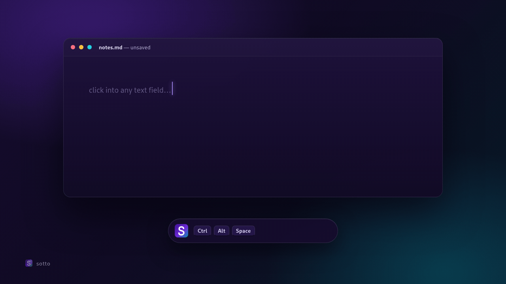

<p align="center">
  
</p>

<h1 align="center">Sotto</h1>

<p align="center"><b>Offline voice typing for Linux.</b><br>
Press <kbd>Ctrl</kbd> + <kbd>Alt</kbd> + <kbd>Space</kbd>, talk, press it again — the words land in whatever field your cursor is in.</p>

<p align="center">
  <b>Shortcut: <kbd>Ctrl</kbd> + <kbd>Alt</kbd> + <kbd>Space</kbd></b><br>
  <sub>Press once to start listening; press the same shortcut again to stop and type the rest. There is no separate stop key.</sub>
</p>

<p align="center">
  
</p>
<p align="center"><sub>Re-created for this page — the real thing types at this pace.</sub></p>

---

*Sotto voce* is Italian for "in a low voice". You mutter under your breath;
Sotto writes it down. No account, no upload, no word limit, nothing to
subscribe to. Wayland and X11. English, Urdu, and 90 more languages — non-Latin
scripts (Urdu, Arabic, Hindi) need Wayland, because they go through the
clipboard. Runs on the CPU.

## Why it exists

Typing is slower than talking. Whisper already turns speech into text — it
just never got that text into the app you were typing in, on Linux, without a
subscription.

Sotto is that last step. It records, transcribes locally, and types the result
wherever your cursor is, while you are still speaking.

If you have been searching for *Whisper for Linux* — this is the half that
types.

## Install

Two commands:

```bash
git clone https://github.com/sahil2837j-eng/sotto.git
cd sotto && ./setup
```

Or, if you would rather not clone first — the script fetches its own files:

```bash
curl -fsSL https://raw.githubusercontent.com/sahil2837j-eng/sotto/main/setup | bash
```

The installer walks six steps and asks before each change:

1. checks the tools it needs, offers to install the missing ones
2. copies itself to `~/.local/share/sotto`
3. builds a small Python environment with `faster-whisper`
4. loads the `uinput` kernel module and starts the typing daemon
5. writes the application entry that carries the `Ctrl+Alt+Space` shortcut
6. checks every piece and tells you what (if anything) is still wrong

The two root-level things are unavoidable, because Linux does not let a normal
program type into other windows:

```bash
# loaded now, and at every boot
sudo modprobe uinput
echo uinput | sudo tee /etc/modules-load.d/uinput.conf

# a daemon holding /dev/uinput open, giving you a private socket
sudo install -m 644 packaging/ydotoold@.service /etc/systemd/system/ydotoold@.service
sudo systemctl enable --now ydotoold@$(id -u)
```

`/dev/uinput` is `root:input 0660`. Either add yourself to the `input` group
and log out, or let the unit above run the daemon as root and hand you a socket
you own — no group change, no logout.

Uninstall with `./setup --uninstall`. Your recordings are left alone.

## Use

1. Put the cursor where the text should go.
2. Press **<kbd>Ctrl</kbd> + <kbd>Alt</kbd> + <kbd>Space</kbd>** — hold
   <kbd>Ctrl</kbd> and <kbd>Alt</kbd>, tap <kbd>Space</kbd>. A beep, and the
   listening strip appears.
3. Talk. Words start appearing after about five seconds.
4. Press **the same shortcut** again. Second beep, the strip leaves, the rest
   lands.

> **Start and stop use the same shortcut.** It is a toggle; there is no second
> hotkey to learn.

To change it, edit the **Sotto** entry in System Settings → Keyboard →
Shortcuts.

It streams: each ~3 second slice is transcribed and typed while the next one
is still being recorded. You are not waiting for the whole take.

## While you talk

A small strip sits at the bottom of the screen for as long as the microphone
is open: the Sotto mark, a red dot, and seven bars of your real input level.
It stays above other windows, never takes focus, and clicks pass through it.

Flat bars mean silence. If the default microphone is muted, a slash crosses
them, so a muted mic is not mistaken for a quiet one.

The strip needs Wayland plus GTK4 and `gtk4-layer-shell` (on Arch:
`sudo pacman -S gtk4-layer-shell python-gobject`). Without them Sotto still
works — the desktop notification is the fallback. Set `SOTTO_INDICATOR=0` to
turn the strip off.

## Languages

Sotto detects the language from your first words and keeps it for that take.
Re-checking every short slice made the language flip mid-sentence (German in
one real take) and produced garbage, so it does not re-detect until the next
take.

To pick the language yourself:

```bash
export SOTTO_LANGUAGE=ur    # en, hi, ar, es, tr, ... 90+
```

Latin text is typed key by key. Anything non-ASCII (Urdu, Arabic, Hindi) goes
through the clipboard and is pasted with `Ctrl+V`, because `ydotool` can only
send physical keycodes. That replaces your clipboard for that utterance.

## Choose the model

```bash
export SOTTO_MODEL=base     # faster, less accurate
export SOTTO_MODEL=medium   # slower, better Urdu (~1.5 GB download)
export SOTTO_FAST_MODEL=tiny  # smaller download, less first-slice accuracy
export SOTTO_FAST_MODEL=none  # use only SOTTO_MODEL (slower cold start)
```

Default is `small` for the main model and `base` for the first slice: the
best balance on a CPU-only machine.

## Speed, honestly

On a 4-core i5-8350U: the first words appear in under five seconds — a 2
second first slice, decoded by the small `base` first-slice model while the
main model finishes loading. After that a fresh slice lands every ~3 seconds,
decoded by the main `small` model while you keep talking. When you stop, the
last words land about three seconds later.

Each slice commits only the words that end before the next slice's overlap;
the next slice re-reads the boundary with the right context. That is why a
misheard word at an edge cannot be typed twice or leak into the rest of the
take. If the machine is busy and a slice runs long, Sotto transcribes one
larger slice to catch up instead of letting the lag grow for the whole take.

The models stay loaded for 30 idle minutes. The first sentence after that
starts on the fast model while the main model warms up, so it no longer pays
the full cold-start penalty. Set `SOTTO_FAST_MODEL=none` to use only the main
model, or `SOTTO_FAST_MODEL=tiny` to trade some first-slice accuracy for an
even smaller download.

Short takes and the fallback path still transcribe the whole file at once: a
10 second sentence takes ~15 seconds there. Streaming is what hides that.

## Troubleshooting

**It hears you, but nothing is typed.** Almost always one of two things: the
`uinput` device, or a typing daemon whose socket vanished. Older installs kept
that socket in `/run/user`, which logind recreates at login — the daemon keeps
running, the client can no longer connect, and the log says
`insert failed: ydotool type:`.

```bash
ls /dev/uinput                       # must exist
ls -l /run/ydotoold-$(id -u).socket  # must exist
systemctl is-active ydotoold@$(id -u) || systemctl is-active ydotoold.service
journalctl -u ydotoold@$(id -u) -n 20
```

Re-run `./setup --yes`: it rewrites the daemon unit with the socket in `/run`
and restarts it. `dictate` finds the socket by itself.

**It types into the wrong place.** Text goes wherever focus is at the moment
of typing. Wait for the beep before clicking away.

**Urdu comes out as broken English.** Pin the language with
`SOTTO_LANGUAGE=ur`, or move from `base` to `small` or `medium`.

**<kbd>Ctrl</kbd> + <kbd>Alt</kbd> + <kbd>Space</kbd> does nothing.** Log out
and back in once so KDE picks up the new entry, or bind it by hand in System
Settings → Keyboard → Shortcuts.

## Files

| Path | Purpose |
|---|---|
| `dictate` | the toggle the hotkey runs: start → stop → transcribe → type |
| `indicator.py` | the little listening strip (Wayland layer-shell, real mic level) |
| `streamer.py` | live slicing: first slice at 2 s, then every ~3 s, commits only confirmed words |
| `model_server.py` | keeps the main model, the fast first-slice model, and the tiny language detector resident; exits after 30 min idle |
| `transcribe.py` | one-shot path, also the fallback when streaming fails |
| `vdlib.py` | shared helpers: server socket, text insertion, history |
| `setup` | the installer above |
| `packaging/` | systemd unit and desktop entry templates |
| `assets/` | icon |
| `sounds/` | start and stop beeps |

Every take gets its own wav under `state/takes/`, so starting a new one can
never overwrite the previous recording. `history.log` keeps what you dictated;
delete it whenever you like.

## Not affiliated

Uses [faster-whisper](https://github.com/SYSTRAN/faster-whisper) and OpenAI's
Whisper models, [ydotool](https://github.com/ReimuNotMoe/ydotool), and
[wl-clipboard](https://github.com/bugaevc/wl-clipboard). Sotto is not
affiliated with OpenAI, Microsoft, or KDE.

## License

MIT. See [LICENSE](LICENSE).
